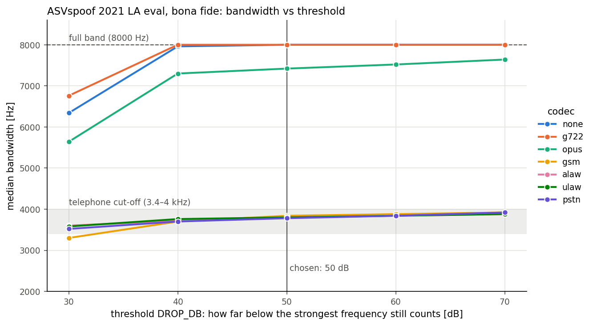
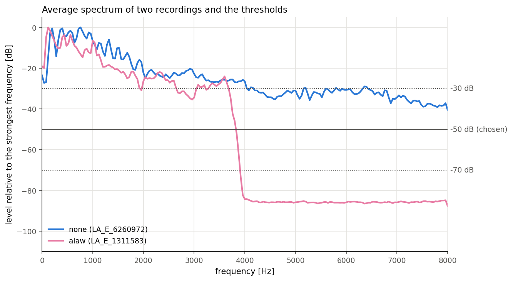

# Choice of the bandwidth threshold (DROP_DB)

- Notebook: `notebooks/09b_bandwidth_threshold_choice.ipynb`
- Recordings: ASVspoof 2021 LA eval, bona fide, 10 per codec (seed 4)

## Median bandwidth [Hz] per codec and threshold

| codec | 30 dB | 40 dB | 50 dB | 60 dB | 70 dB |
|---|---|---|---|---|---|
| none | 6340 | 7960 | 8000 | 8000 | 8000 |
| g722 | 6760 | 8000 | 8000 | 8000 | 8000 |
| opus | 5640 | 7300 | 7420 | 7520 | 7640 |
| gsm | 3300 | 3700 | 3840 | 3880 | 3920 |
| alaw | 3600 | 3720 | 3800 | 3840 | 3880 |
| ulaw | 3580 | 3760 | 3800 | 3840 | 3880 |
| pstn | 3520 | 3700 | 3780 | 3840 | 3920 |

## Conclusion

- At 30 dB a recording without a codec reaches only 6340 Hz instead of 8000 Hz: the weak but real high frequencies of speech count as absent.
- At 50 dB recordings without a codec reach 8000 Hz and the telephone codecs 3780–3840 Hz, which matches their known cut-off (3.4–4 kHz).
- Above 50 dB the telephone bandwidth creeps up (at 70 dB: 3880–3920 Hz), because the noise above the cut-off starts to count as sound.
- Single recordings vary: at 50 dB the recordings without a codec reach 5840–8000 Hz (median 8000 Hz), because the high frequencies of some voices are very weak; the telephone codecs 3680–8000 Hz.
- Therefore DROP_DB = 50 dB was chosen.
